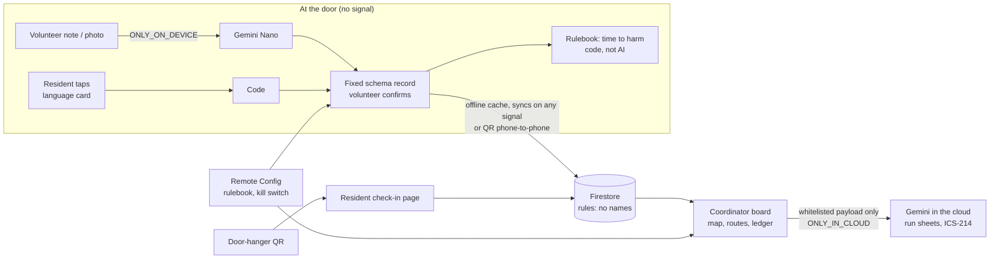

# Muster

**After a disaster, many deaths come in the days after the storm, not during it.** The oxygen concentrator's battery runs out, insulin goes warm, a dialysis session is missed, and a man over 65 who lives alone is never checked.
Muster finds those households **before their time runs out**, even when every cell tower is down.

- **Hurricane Maria (2017):** about one third of an estimated 4,645 excess deaths were attributed to delayed or interrupted medical care. *(Kishore et al., NEJM 2018)*
- **2021 heat dome, Multnomah County:** 71% of the people who died lived alone, and 94% died at home. *(Multnomah County)*
- **Hurricane Helene (2024):** about 74% of cell sites in the affected North Carolina counties were offline at peak. *(FCC data)*

Built for **#BuildHybridAI 2026** with **Firebase AI Logic hybrid inference** · Web (Chrome) + Android.

**Live:** https://muster-hybrid.web.app · **For judges:** https://muster-hybrid.web.app/#/judges

---

## Try it in five minutes (judges)

1. Open **https://muster-hybrid.web.app** → **Open app**. Join with the demo code given in the Devpost submission (or scan the coordinator's invite QR).
2. **Coordinator** tab → **Load demo households**. The real map of Marshall, NC fills with synthetic households, clocks and team routes.
3. **Generate run sheets** → press **Show exactly what is sent** first. The answer is labelled **Cloud**.
4. **Doors** tab → pick a door → **Ask in their language** → choose Kreyòl, Español, العربية… and answer as the resident. The record fills and the rulebook marks it.
5. Pick a door → **Nobody answered**. A door-hanger with a QR appears; open it on a phone and check in as the resident (6 languages).
6. **Accuracy** tab → the measured results below, and a button to re-run them yourself.
7. Turn on airplane mode, capture a household, reconnect, watch it sync.

**On-device AI in Chrome** (desktop Chrome 138+): `chrome://flags` → **Prompt API** → Enabled → Relaunch. Then in DevTools: `await LanguageModel.availability()`; if it says `downloadable`, the app's **Install on-device AI** button (or any click calling `LanguageModel.create()`) starts the ~2 GB download.

**Android:** install the APK from [Releases](https://github.com/angelraph/muster/releases), open, swipe the welcome, **Scan invite QR**.

---

## Measured accuracy (not estimated)

30 synthetic doorstep notes with hand-labelled answers ([`shared/eval/doorstep-notes.json`](shared/eval/doorstep-notes.json)). Same schema and rulebook on every run. Raw per-note scores: [`shared/eval/results.json`](shared/eval/results.json).

| Run | Stated-field accuracy | Priority agreement | Unsafe misses | Avg time per note |
|---|---|---|---|---|
| Cloud · `gemini-3.5-flash-lite` · prompt v1 | 91% | 87% | 3 | 1.2 s |
| Cloud · `gemini-3.5-flash-lite` · prompt v2 | **94%** | **97%** | **0** | 1.2 s |
| **On-device · Gemini Nano in Chrome · prompt v2** | 58% | 80% | 1 | 56 s* |

\*On a 2017 laptop (Intel i5-7300U, 2 cores, Intel HD 620), below Chrome's recommended hardware.

- **Stated-field accuracy** scores only what the note actually says. **Priority agreement** runs the rulebook on the extraction and on the true answer. An **unsafe miss** is a truly urgent household the extraction would not mark urgent.
- Prompt v1 → v2 fixed the three measured failure modes (devices on battery/generator, missed dialysis sessions). Same prompt on web and Android.
- **What the on-device numbers mean:** Nano errs toward caution (5 of its 6 priority errors over-flag, mostly by assuming a device without power), and missed one urgent household. That is exactly why the volunteer confirms every field, why the tap form exists, and why the cloud model takes over for anything that can wait for signal.

---

## What it does

| | |
|---|---|
| **Doorstep intake, offline** | The volunteer speaks or types what they see. Gemini Nano turns it into a fixed record **on the device** (`ONLY_ON_DEVICE`). The volunteer confirms every field. |
| **Resident language card** | The volunteer hands over the phone. Consent and 11 key questions in **English, Español, Kreyòl ayisyen, Français, العربية (RTL), Yorùbá**, with big tap answers. Code (not AI) turns the taps into the record. Bundled, so it works with no signal. |
| **Label photo, offline** | A photo of an insulin pen or an oxygen-device plate fills fields on-device. The photo never leaves the device. |
| **Time-to-harm clock** | Code computes a deadline for each household from an agency-owned rulebook ("oxygen: 2 h 0 m", "dialysis: overdue"). **The AI never decides who gets help first.** Every threshold cites its source. |
| **Unknown is never "safe"** | A missing critical fact (does the device have power?) makes the household urgent, with a short recheck and the exact question to ask. |
| **No answer ≠ safe: door-hangers** | "Nobody answered" prints a door-hanger with a one-time QR. The resident checks in later from any phone, in their language: *We are OK* or *We need: oxygen power / insulin / water / help to leave*. Firestore rules allow exactly one check-in per code. |
| **Agency registry import** | Drop in a CSV of consented at-risk addresses (HHS emPOWER-style). Parsed in the browser, never uploaded raw. Those homes go to the top of every list as **known risk, unchecked**. |
| **Real map, real place** | Marshall, NC (hit by Hurricane Helene) from OpenStreetMap: 60 real addressed homes, streets, the French Broad River, Town Hall as staging. Ships as a static file, so it works offline. |
| **Deadline-aware routing** | Earliest-deadline-first, weighted by real travel distance (OSM metres, ×1.35 detour, 12 km/h on foot/debris, 8 min per stop). Each stop shows ETA and slack: "reaches oxygen with 1 h 40 m to spare". |
| **QR handoff** | With no network at all, records hop phone to phone as animated QR codes. Whoever reaches signal first syncs everyone. |
| **Invite volunteers** | The coordinator's board shows the join code, a QR that opens the app with it filled in, and a printable staging-area poster. Android joins by scanning the same QR. |
| **Inference Ledger** | Every AI call is logged locally: mode, `inferenceSource`, latency, bytes sent, and *why* that mode. The app bar shows a live **"doorstep data uploaded: 0 B"**. |
| **Field mode** | Glove-friendly huge targets, then a red night mode. Haptics on Android. |
| **ICS-214 export** | The cloud drafts the standard FEMA activity log from the records, printable. |
| **Remote Config is operational** | Switch the incident type, update the rulebook, swap the cloud model, or kill all cloud AI, live. |

## How hybrid inference is used

Each mode has a physical reason:

| Moment | Mode | Why |
|---|---|---|
| Doorstep note / photo → record | `ONLY_ON_DEVICE` | No signal at the door, and a stranger's medical situation shouldn't be uploaded. If the model isn't ready, Muster **refuses and opens the tap form**. There is no cloud fallback for doorstep data. |
| One-line household summary (coordinator) | `PREFER_ON_DEVICE` | Works even if the shelter's link drops. The input is the whitelisted cloud-safe record. |
| Run sheets, shift handover, ICS-214, label translation | `ONLY_IN_CLOUD` | Needs **every volunteer's records at once**, which no single device has. |

`response.inferenceSource` is shown on every AI result as "On this device" or "Cloud", and every call lands in the Inference Ledger.



**Voice:** on-device Gemini does not accept audio, so speech is transcribed first, and only by an on-device recognizer (Chrome `processLocally`, Android `createOnDeviceSpeechRecognizer`). Otherwise the volunteer types.

## Privacy by construction (and tested)

- **Schema:** the household schema has **no name field** ([`shared/extraction.schema.json`](shared/extraction.schema.json)).
- **Cloud payloads:** built by **whitelist** ([`web/src/core/payload.ts`](web/src/core/payload.ts)). Door descriptions, transcripts, photos and volunteer IDs cannot be included, and a runtime guard rejects any request containing them.
- **Firestore rules** reject any household document with fields outside the schema, so even a modified client can't store a name or transcript ([`firebase/firestore.rules`](firebase/firestore.rules)). Resident check-ins have no free text.
- **Cloud output is checked:** a stop the cloud adds that code didn't plan is removed and reported. Stop order is computed by code ([`web/src/core/plan.ts`](web/src/core/plan.ts)).
- **Doorstep notes and photos** stay on the volunteer's device. The invite code travels in the URL fragment, which browsers never send to a server.

## One rules engine, two platforms

[`shared/rule-test-vectors.json`](shared/rule-test-vectors.json) holds 16 cases. The TypeScript engine and the Kotlin engine must both pass the same file, so phone and laptop always compute the same deadline. The language card and the rulebook are shared JSON files bundled into both apps.

## Firebase products

- **Firebase AI Logic** (hybrid inference: `ONLY_ON_DEVICE`, `PREFER_ON_DEVICE`, `ONLY_IN_CLOUD`)
- **App Check** (reCAPTCHA Enterprise on web, Play Integrity / debug provider on Android)
- **Firestore** (offline persistence, membership and one-time check-in rules)
- **Anonymous Auth** + incident join codes
- **Remote Config** (incident template, rulebook with sources, cloud kill switch, cloud model)
- **Hosting**

## Run it

```bash
cd web
npm install
npm test          # rules engine, privacy, merge, planning, routing, QR handoff, accuracy scoring, language card
npm run dev       # http://localhost:5173 — works in demo mode without Firebase
```

**Demo mode** (no Firebase config): tap mode, a local store synced between browser tabs, and demo switches standing in for Remote Config.

**With Firebase:**
1. Copy `web/.env.example` to `web/.env.local` and paste your web `firebaseConfig`.
2. Deploy rules and the Remote Config template: `firebase deploy --only firestore:rules,remoteconfig`.
3. Create `incidents/demo-riverside` in Firestore with a `joinCode` field. Promote coordinators by setting `role: "coordinator"` on their `members/{uid}` document.
4. **App Check for local runs:** set `VITE_APPCHECK_DEBUG=true`, then register the token printed in the console under Firebase console → App Check → Manage debug tokens.

**Android** (Kotlin + Jetpack Compose, `firebase-ai` + `firebase-ai-ondevice`, KSP `@Generable` schema):
```bash
cd android
./gradlew :app:testDebugUnitTest   # Kotlin engine passes the same shared vectors + QR codec tests
./gradlew :app:assembleDebug       # app/build/outputs/apk/debug/app-debug.apk
```
- Put your `google-services.json` in `android/app/`. Without it, the app runs in local demo mode.
- On phones with Gemini Nano (AICore), doorstep notes and label photos are read in `ONLY_ON_DEVICE` mode. Every other phone says so and uses the tap form and language card; records still sync and still get clocks.

## Honest limits

- On-device accuracy is far below cloud accuracy on weak hardware (see the table). Muster treats on-device output as a first draft the volunteer confirms, never as the decision.
- The language card's translations were drafted with AI assistance; an agency should have native speakers review them before field use.
- The rulebook thresholds are cited examples, not clinical guidance. The agency owns them.
- iOS is not built.

## Not medical advice

Muster does needs intake and logistics. Every threshold comes from the responding agency's rulebook in Remote Config. The values shipped here are clearly labelled examples with sources.

## Data and credits

Map data © OpenStreetMap contributors (ODbL). Photography from Unsplash (Unsplash License). Households in demos are synthetic.

## License

Apache-2.0
